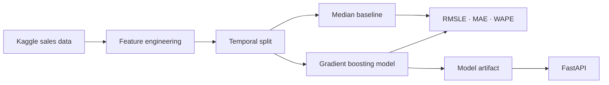

<div align="center">

# FoodDemand AI

### End-to-end retail demand forecasting with temporal validation and a production-style API

`Python` · `Pandas` · `scikit-learn` · `FastAPI` · `Docker` · `GitHub Actions`

</div>

---

## Why this project exists

FoodDemand AI is a portfolio project for forecasting product demand from historical retail sales.
The goal is not only to train a model, but to demonstrate an **engineering workflow around ML**:
leakage-safe features, temporal validation, comparison against a simple baseline, reproducible
training, automated tests and an inference API.

The first version uses the public **Store Sales - Time Series Forecasting** dataset from Kaggle.

## What is implemented

- calendar features and promotion signals;
- demand lags at 7, 14 and 28 days;
- rolling means built only from previous observations;
- chronological holdout validation;
- median baseline per store/product family;
- `HistGradientBoostingRegressor` model;
- RMSLE, MAE and WAPE evaluation;
- persisted model artifact with `joblib`;
- FastAPI `/predict` and `/health` endpoints;
- Pytest test suite and Ruff linting;
- GitHub Actions CI;
- Docker image running as a non-root user.

## Architecture



See [the architecture notes](docs/architecture.md) for the evaluation assumptions and roadmap.

## Quick start

### 1. Create the environment

```bash
git clone https://github.com/Cassio327/fooddemand-ai.git
cd fooddemand-ai

python3 -m venv .venv
source .venv/bin/activate
python -m pip install --upgrade pip
pip install -e ".[dev,data]"
```

### 2. Download the dataset

Accept the Kaggle competition rules and configure your Kaggle credentials, then run:

```bash
bash scripts/download_data.sh
```

The raw files stay under `data/raw/` and are not committed to the repository.

### 3. Train

For a faster local experiment using the most recent 500,000 rows:

```bash
python -m fooddemand.train \
  --data data/raw/train.csv \
  --max-rows 500000 \
  --validation-days 28
```

For a full-data experiment, omit `--max-rows`.

Training writes:

```text
models/fooddemand.joblib
reports/latest_metrics.json
```

The report includes both the baseline and ML metrics so improvements can be measured explicitly.

### 4. Run tests

```bash
pytest -q
ruff check .
```

### 5. Serve predictions

After training:

```bash
uvicorn app.main:app --reload
```

Open:

- API docs: `http://127.0.0.1:8000/docs`
- health: `http://127.0.0.1:8000/health`

Example request:

```json
{
  "date": "2017-08-16",
  "store_nbr": 1,
  "family": "GROCERY I",
  "onpromotion": 14,
  "lag_7": 220.0,
  "lag_14": 215.0,
  "lag_28": 208.0,
  "rolling_mean_7": 218.4,
  "rolling_mean_28": 210.7
}
```

## Metrics

This repository does **not** publish invented model scores. Real metrics should only be added after
running the pipeline on the downloaded competition data. The evaluation report is generated at
`reports/latest_metrics.json`.

The main competition-oriented metric is **RMSLE**. MAE and WAPE are also reported to make errors
easier to interpret operationally.

## Repository structure

```text
app/                       FastAPI service
data/                      dataset instructions; raw files ignored
docs/                      design and evaluation notes
models/                    local trained artifacts; ignored
scripts/                    data acquisition helpers
src/fooddemand/             ML package
tests/                     deterministic unit/smoke tests
.github/workflows/ci.yml   lint and test pipeline
Dockerfile                 non-root API image
```

## Engineering choices

**Why temporal validation?** Random train/test splits leak future patterns into the past and can
produce misleading scores for forecasting problems.

**Why a baseline?** A model should beat a simple heuristic before its complexity is justified.

**Why lagged features?** Recent demand is usually more informative than calendar variables alone.
The implementation shifts the target before rolling calculations so the current target does not
leak into its own prediction.

**Why no leaderboard score yet?** Reproducibility matters more than claiming a result that has not
been rerun and verified. Experiment outputs will be added as the project evolves.

## Roadmap

- [x] Reproducible training pipeline
- [x] Leakage-safe historical features
- [x] Temporal validation and baseline comparison
- [x] Automated tests and CI
- [x] FastAPI inference service
- [x] Docker image
- [ ] Add holidays, oil, transactions and store metadata
- [ ] Recursive multi-step backtesting
- [ ] MLflow experiment tracking
- [ ] Compare additional boosting models
- [ ] Publish the selected model and model card on Hugging Face
- [ ] Add an interactive forecasting dashboard

## License

MIT. Dataset usage remains subject to the Kaggle competition rules.
