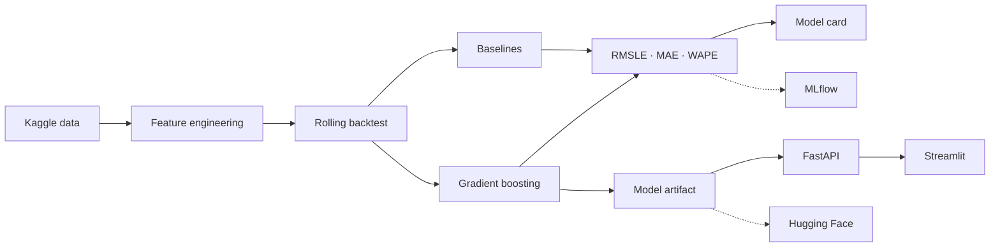

<div align="center">

# FoodDemand AI

### End-to-end retail demand forecasting: data → backtesting → model → API → dashboard

[](https://github.com/Cassio327/fooddemand-ai/actions/workflows/ci.yml)

`Python` · `Pandas` · `scikit-learn` · `Time Series` · `FastAPI` · `Docker` · `MLflow` · `Hugging Face`

</div>

---

## Why this project exists

FoodDemand AI forecasts retail product demand from historical sales. It was designed as an
**AI/ML engineering portfolio project**, not as a notebook-only experiment: the repository includes
leakage-safe feature engineering, chronological backtesting, baselines, a versioned model artifact,
a REST API, a Streamlit demo, Docker, automated tests, CI, optional MLflow tracking and a Hugging
Face publishing path.

The dataset is the public **Store Sales - Time Series Forecasting** Kaggle competition. The data is
from Corporación Favorita in Ecuador and is used only as a public proxy for a real retail forecasting
problem.

## What the system demonstrates

- demand lags at 7, 14 and 28 days;
- rolling historical means built after shifting the target;
- calendar and promotion signals;
- store metadata, national holidays, lagged oil price and lagged transactions;
- rolling-origin temporal backtesting;
- median and 7-day seasonal-naive baselines;
- log-target `HistGradientBoostingRegressor`;
- RMSLE, MAE and WAPE;
- versioned `joblib` artifact with training metadata;
- FastAPI single and batch inference endpoints;
- Streamlit demo dashboard;
- optional MLflow experiment tracking;
- model-card generation and Hugging Face publication script;
- unit, API and end-to-end synthetic tests in GitHub Actions;
- API and dashboard Docker images.

## Architecture



More details: [architecture](docs/architecture.md) · [evaluation](docs/evaluation.md) ·
[engineering decisions](docs/decisions.md) · [deployment](docs/deployment.md)

## Quick start

### 1. Install

```bash
git clone https://github.com/Cassio327/fooddemand-ai.git
cd fooddemand-ai
python3 -m venv .venv
source .venv/bin/activate
python -m pip install --upgrade pip
pip install -e ".[dev,portfolio]"
```

### 2. Get the official data

After accepting the Kaggle competition rules and configuring the Kaggle API:

```bash
make data
```

Raw files remain ignored by Git.

### 3. Generate EDA + train + backtest

```bash
make portfolio
```

Outputs:

```text
models/fooddemand.joblib
reports/latest_metrics.json
reports/MODEL_CARD.md
reports/eda_summary.json
reports/figures/daily_sales.png
reports/figures/top_families.png
```

The repository intentionally does **not** hard-code or invent benchmark numbers. Real metrics appear
only after the official dataset is executed.

### 4. Run the API

```bash
make api
```

- Swagger: `http://127.0.0.1:8000/docs`
- Health: `GET /health`
- Model metadata: `GET /model`
- Single prediction: `POST /predict`
- Batch prediction: `POST /predict/batch`

### 5. Run the dashboard

```bash
make dashboard
```

Open `http://127.0.0.1:8501`.

### 6. Run everything with Docker

```bash
docker compose up --build
```

API: `http://127.0.0.1:8000` · Dashboard: `http://127.0.0.1:8501`

## No Kaggle credentials? Run the full smoke demo

```bash
make demo
```

This creates synthetic retail data and exercises the same end-to-end training pipeline. **Synthetic
scores are integration-test evidence only and must not be presented as real model performance.**

## Evaluation design

Random splitting is avoided. The model is evaluated on multiple chronological windows and compared
with a 7-day seasonal-naive forecast and a historical-median baseline.

Historical target features are shifted before use, so the current target never becomes its own
feature. Same-day transactions are also excluded; only previous-day transaction information can be
used.

The main competition-oriented metric is RMSLE. MAE and WAPE are reported for operational
interpretability.

## MLflow

```bash
pip install -e ".[tracking]"
mlflow server --host 127.0.0.1 --port 5000
export MLFLOW_TRACKING_URI=http://127.0.0.1:5000
python -m fooddemand.train --data-dir data/raw --mlflow
```

## Publish the model to Hugging Face

After a verified real-data run:

```bash
pip install -e ".[publish]"
export HF_TOKEN=YOUR_PRIVATE_TOKEN
python scripts/publish_huggingface.py --repo-id Cassio327/fooddemand-ai
```

Never commit the token.

## Repository structure

```text
app/                         FastAPI service
dashboard/                   Streamlit portfolio demo
src/fooddemand/
  data.py                    competition data loader
  features.py                leakage-safe features and data enrichment
  backtest.py                rolling-origin windows
  model.py                   preprocessing + estimator
  metrics.py                 RMSLE, MAE and WAPE
  train.py                   end-to-end training and evaluation
  predict.py                 artifact loading and inference
  eda.py                     reproducible EDA outputs
  model_card.py              Hugging Face model-card generation
scripts/
  download_data.sh           Kaggle data acquisition
  generate_demo_data.py      deterministic synthetic CI/demo dataset
  run_portfolio.sh           complete real-data portfolio run
  publish_huggingface.py     model publishing helper
tests/                       feature, metric, backtest, training and API tests
docs/                        architecture, evaluation, decisions and deployment
.github/workflows/ci.yml     lint, tests, E2E smoke training and Docker builds
```

## Current limitations

- The evaluation is rolling one-step, not a fully recursive fixed-horizon forecast.
- The public Ecuadorian grocery dataset is not representative of iFood's private data.
- The serving API receives historical lag features instead of maintaining an online feature store.
- Real benchmark metrics and the Hugging Face artifact require executing the official Kaggle data.

These limitations are explicit because a reliable ML portfolio should distinguish what was measured
from what is planned.

## License

MIT for the source code. Dataset usage is governed separately by the Kaggle competition rules.
