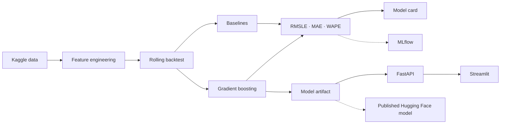

<div align="center">

# FoodDemand AI

### End-to-end retail demand forecasting: data → backtesting → model → API → dashboard

[](https://github.com/Cassio327/fooddemand-ai/actions/workflows/ci.yml)

`Python` · `Pandas` · `scikit-learn` · `Time Series` · `FastAPI` · `Docker` · `MLflow` · `Hugging Face`

**[Published model & Model Card (Hugging Face)](https://huggingface.co/cassiohfs/fooddemand-ai)** · **[Verified Kaggle benchmark](reports/benchmark_600k.json)** · **[API documentation (run locally)](#4-run-the-api)**

</div>

---

## Why this project exists

FoodDemand AI forecasts retail product demand from historical sales. It was designed as an
**AI/ML engineering portfolio project**, not as a notebook-only experiment: the repository includes
leakage-safe feature engineering, chronological backtesting, baselines, a versioned model artifact,
a REST API, a Streamlit demo, Docker, automated tests, CI, optional MLflow tracking and a Hugging
Face model publication.

The dataset is the public **Store Sales - Time Series Forecasting** Kaggle competition. The data is
from Corporación Favorita in Ecuador and is used only as a public proxy for a real retail forecasting
problem.

## Verified Kaggle benchmark

FoodDemand AI was trained and evaluated on **real Store Sales data**, using a
chronological **rolling one-step** backtest.

| Measure | Result |
| --- | ---: |
| Rows loaded (recent-data subset) | **598,752** |
| Model-ready rows after historical features | **547,074** |
| Validation | **3 folds × 16 days** |
| Historical median baseline RMSLE | 0.8314 |
| Seasonal naive (7-day) RMSLE | 0.5316 |
| **FoodDemand AI RMSLE** | **0.3802** |
| **Relative RMSLE reduction vs seasonal naive** | **28.48%** |
| Seasonal naive vs model MAE | 87.1732 → **60.3452** |
| Seasonal naive vs model WAPE | 18.27% → **12.65%** |

Metrics are the **unweighted average of the three folds**. The final fold's model RMSLE
was **0.3870**. These results evaluate next-day predictions with updated historical
observations available across the validation window; they **do not** represent a
fully recursive 16-day forecast or an official Kaggle leaderboard submission.

**Dataset:** [Kaggle Store Sales - Time Series Forecasting](https://www.kaggle.com/competitions/store-sales-time-series-forecasting).
This experiment used 598,752 of the dataset's 3,000,888 training rows because full-data
training exceeded the available RAM on the local laptop.

**Evidence:** [benchmark report](reports/benchmark_600k.json) ·
[latest metrics](reports/latest_metrics.json) ·
[model card](reports/MODEL_CARD.md).

**Published artifact:** [cassiohfs/fooddemand-ai on Hugging Face](https://huggingface.co/cassiohfs/fooddemand-ai).
The Hugging Face repository provides the trained model and documentation; it is
**not** a hosted inference endpoint. The API and dashboard can be run locally
using the instructions below.

## Demo

**Current status: the app and API were tested locally; an edited public demo video has not yet been uploaded.**

> **Video / GIF placeholder:** add the recording URL here after uploading the final FoodDemand AI demo. Do not use a broken link or a sample animation presented as a real run.

<!-- TODO: Replace this comment with a public video/GIF link and, optionally,
     a preview image, once the final application recording is published. -->

**Suggested 60–90 s recording:**

1. Open the Streamlit dashboard at `http://127.0.0.1:8501` and show the real benchmark summary.
2. Submit an illustrative demand-forecast request using lag and promotion inputs; show the returned estimate.
3. Open FastAPI Swagger at `http://127.0.0.1:8000/docs` and show a successful `POST /predict` request.
4. Show this repository and the [published model artifact on Hugging Face](https://huggingface.co/cassiohfs/fooddemand-ai).

The interactive request demonstrates **model serving**, not model accuracy: performance evidence comes from the chronological backtesting reports above. This dashboard requires the API and model artifact to be available locally; it is not a hosted public demo.

## What the system demonstrates

- calendar-day demand lags at 7, 14 and 28 days, robust to missing dates;
- rolling historical means built after shifting the target;
- calendar and promotion signals;
- store metadata, national holidays, lagged oil price and lagged transactions;
- rolling-origin temporal backtesting;
- median and 7-day seasonal-naive baselines;
- log-target `HistGradientBoostingRegressor` with native categorical splits;
- RMSLE, MAE and WAPE;
- versioned `joblib` artifact with training metadata;
- FastAPI single and batch inference endpoints;
- Streamlit demo dashboard;
- optional MLflow experiment tracking;
- model-card generation and Hugging Face publication script;
- unit, API and end-to-end synthetic tests in GitHub Actions;
- API and dashboard Docker images.

## Architecture



More details: [architecture](docs/architecture.md) · [evaluation](docs/evaluation.md) ·
[engineering decisions](docs/decisions.md) · [deployment](docs/deployment.md) ·
[trained model + Model Card on Hugging Face](https://huggingface.co/cassiohfs/fooddemand-ai)

## Quick start

### 1. Install

```bash
git clone https://github.com/Cassio327/fooddemand-ai.git
cd fooddemand-ai
python3 -m venv .venv
source .venv/bin/activate
python -m pip install --upgrade pip
pip install -e ".[dev,portfolio]"
```

### 2. Get the official data

After accepting the Kaggle competition rules and configuring the Kaggle API:

```bash
make data
```

Raw files remain ignored by Git.

### 3. Generate EDA + train + backtest

```bash
make portfolio
```

Outputs:

```text
models/fooddemand.joblib
reports/latest_metrics.json
reports/MODEL_CARD.md
reports/eda_summary.json
reports/figures/daily_sales.png
reports/figures/top_families.png
```

The verified benchmark above was generated from a subset of the official Kaggle data using:

```bash
python -m fooddemand.train --data-dir data/raw --data-source kaggle-store-sales \
  --max-rows 600000 --backtest-folds 3 --validation-days 16
```

Synthetic smoke-test reports are labeled separately and must not be presented as real
benchmark performance.

The `--max-rows` option retains whole dates instead of dropping arbitrary product/store series.
Serving exposes `GET /ready` for model readiness in addition to `GET /health` for liveness.

### 4. Run the API

```bash
make api
```

- Swagger: `http://127.0.0.1:8000/docs`
- Liveness: `GET /health`
- Readiness: `GET /ready`
- Model metadata: `GET /model`
- Single prediction: `POST /predict`
- Batch prediction: `POST /predict/batch`

### 5. Run the dashboard

```bash
make dashboard
```

Open `http://127.0.0.1:8501`.

### 6. Run everything with Docker

```bash
docker compose up --build
```

API: `http://127.0.0.1:8000` · Dashboard: `http://127.0.0.1:8501`

## No Kaggle credentials? Run the full smoke demo

```bash
make demo
```

This creates synthetic retail data and exercises the same end-to-end training pipeline. **Synthetic
scores are integration-test evidence only and must not be presented as real model performance.**

## Evaluation design

Random splitting is avoided. The model is evaluated on multiple chronological windows and compared
with a 7-day seasonal-naive forecast and a historical-median baseline.

Historical target features are shifted before use, so the current target never becomes its own
feature. Same-day transactions are also excluded; only previous-day transaction information can be
used.

The main competition-oriented metric is RMSLE. MAE and WAPE are reported for operational
interpretability.

## MLflow

```bash
pip install -e ".[tracking]"
mlflow server --host 127.0.0.1 --port 5000
export MLFLOW_TRACKING_URI=http://127.0.0.1:5000
python -m fooddemand.train --data-dir data/raw --mlflow
```

## Published Hugging Face model

The trained real-data artifact and its Model Card are available at
**[cassiohfs/fooddemand-ai](https://huggingface.co/cassiohfs/fooddemand-ai)**.

To publish an updated, verified model from your own terminal:

```bash
pip install -e ".[publish]"
hf auth login
export HF_TOKEN="$(python -c 'from huggingface_hub import get_token; print(get_token() or "")')"
python scripts/publish_huggingface.py --repo-id cassiohfs/fooddemand-ai
```

Keep credentials private. `joblib.load` deserializes pickle-based data, so only
load model artifacts from trusted sources.

## Repository structure

```text
app/                         FastAPI service
dashboard/                   Streamlit portfolio demo
src/fooddemand/
  data.py                    competition data loader
  features.py                leakage-safe features and data enrichment
  backtest.py                rolling-origin windows
  model.py                   preprocessing + estimator
  metrics.py                 RMSLE, MAE and WAPE
  train.py                   end-to-end training and evaluation
  predict.py                 artifact loading and inference
  eda.py                     reproducible EDA outputs
  model_card.py              Hugging Face model-card generation
scripts/
  download_data.sh           Kaggle data acquisition
  generate_demo_data.py      deterministic synthetic CI/demo dataset
  run_portfolio.sh           complete real-data portfolio run
  publish_huggingface.py     model publishing helper
tests/                       feature, metric, backtest, training and API tests
docs/                        architecture, evaluation, decisions and deployment
.github/workflows/ci.yml     lint, tests, E2E smoke training and Docker builds
```

## Current limitations

- The evaluation is rolling one-step, not a fully recursive fixed-horizon forecast.
- The public Ecuadorian grocery dataset is not representative of iFood's private data.
- The serving API receives historical lag features instead of maintaining an online feature store.
- Published metrics come from a **598,752-row recent-data subset**, not the entire training set.
- The Hugging Face repository hosts the model artifact, not an always-on prediction API.

These limitations distinguish verified work from future work. Local Docker Compose ports are
bound to `127.0.0.1` to avoid exposing this unauthenticated demo over the local network.

## License

MIT for the source code. Dataset usage is governed separately by the Kaggle competition rules.
