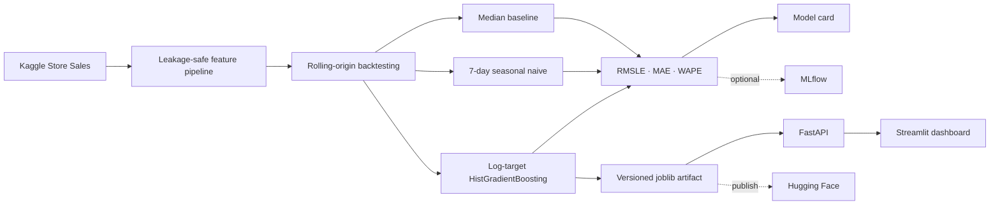

# Architecture

## Leakage controls

Target lags and rolling means are shifted before calculation. Same-day transactions are not used;
transactions are moved to the following calendar day as `transactions_lag_1`. Oil price is forward
filled only from earlier observations and shifted one observation before merge. Calendar holidays
are known in advance and can be used directly.

## Serving contract

The API expects already-computed historical features. This keeps online serving deterministic and
makes the forecasting assumptions explicit. A production forecasting service would own a feature
store or historical state and compute these values automatically.
