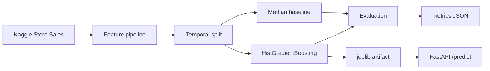

# Architecture

## Forecasting design

The first iteration focuses on a clear, reproducible baseline rather than maximizing leaderboard
score. Every row is identified by `store_nbr`, `family` and `date`.

The model uses calendar, promotion and lagged demand features:

- demand 7, 14 and 28 days earlier;
- rolling mean over the previous 7 and 28 observations;
- calendar fields such as day of week and month;
- number of products on promotion.

Historical features use `shift()` before rolling calculations, so the current day's target is never
used as an input feature.

## Validation

The latest days are held out chronologically. Historical features for a validation day can use
actual observations from earlier dates, which makes this a **rolling one-step forecasting**
evaluation. A future iteration will add recursive multi-step backtesting to reproduce a fixed
forecast horizon.

## Baseline

The comparison baseline predicts the historical median sales for each `(store_nbr, family)` pair.
This prevents the project from presenting a model score without answering whether ML improves on a
simple heuristic.

## Next iterations

1. Add oil, holiday, transaction and store metadata.
2. Add recursive multi-step backtesting.
3. Track experiments with MLflow.
4. Compare tree-boosting alternatives.
5. Publish the selected model and model card to Hugging Face.
6. Add drift and latency monitoring for the API.
